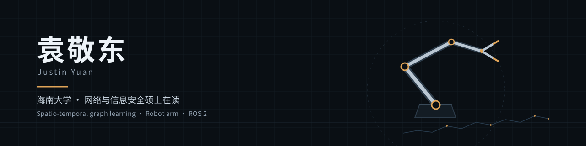

  

我在海南大学读网络与信息安全硕士，本科做的是农产品溯源系统。现在主要看交通流预测这一块，具体是时空图建模：动态图怎么建，GNN 和注意力放在哪儿。机械臂也在做，装配、URDF 建模、遥操作都自己上手，运动学一边学一边用，不想只停在看课上。

*Master's student in Cyber Security, Hainan University · Spatio-temporal graph learning for traffic forecasting · Robot arm and ROS 2*

## 项目

**机械臂**　实验室里的真实机械臂，装配、URDF 建模、遥操作联调都自己上手，运动学一边学一边用。代码没有开源。

**TrustAgent**　给接上工具的大模型加一层管控：Java（Spring Boot）控制面管认证、策略和审计，Python（FastAPI）执行面跑 Agent 编排和内容安检，工具调用在真正执行之前就被策略层拦下来。本机 Java 82 项、Python 267 项测试是过的，也在一台 1 核 2G 的服务器上部署试过；留出集上检测召回率从 0.950 掉到 0.375，这个数我也写进文档了，仓库还没公开。

**repro-verdict**　复现论文时用的检查工具：验收容差在实验前就写进配置，跑完给 A / B / C / F 评级，评分和复核分开做。命令行可以直接跑。
[源码](https://github.com/korelyk/repro-verdict)　[PyPI](https://pypi.org/project/repro-verdict/)　`Python` `MIT`

**agri-traceability-system**　本科毕业设计，农产品防伪溯源。Spring Boot + Vue 3 + uni-app，链上用自己写的 SHA-256 / Merkle Root，溯源交易做 RSA 签名校验，Docker Compose 部署。
[源码](https://github.com/korelyk/agri-traceability-system)　`Java` `Vue` `MySQL`

**bishe-image-classification**　道路目标图像分类：ResNet50、MobileNetV2、EfficientNet-B0 三个模型做对比，加数据增强和 Grad-CAM，最后包成 FastAPI 服务，带后台统计。
[源码](https://github.com/korelyk/bishe-image-classification)　`PyTorch` `FastAPI`

## 在学什么

交通流预测是主线，往下是动态图建模、GNN 和注意力机制。工程这边放机械臂实践和几个软件项目，代码基本都在上面。像 TrustAgent 这种是自己找题练手，不算研究方向。

## 联系

个人站 [www.yjde.de](https://www.yjde.de)，上面也有这个 GitHub 的入口。有问题直接开 Issue。
